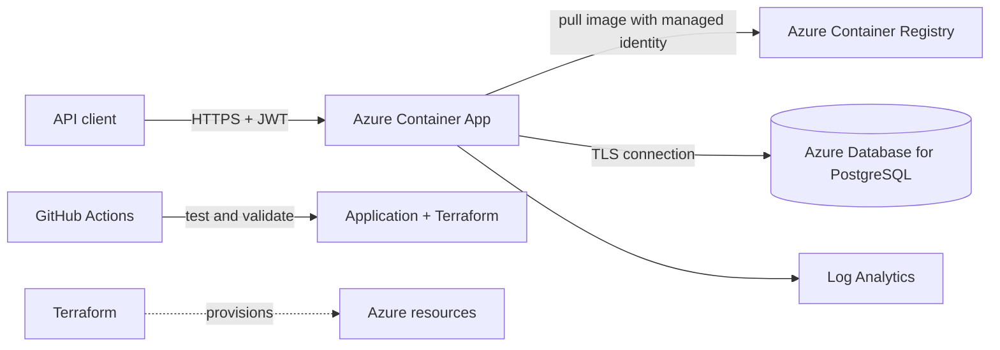

# Cloud-Native Task Management API

A REST API for managing personal tasks. The project combines a
FastAPI application, PostgreSQL persistence, JWT authentication, automated
testing, containerization, continuous integration, and Terraform-managed Azure
infrastructure.

<!-- > **Deployment status:** the API is complete and runs locally with Docker. The
> Azure infrastructure is defined and validated with Terraform, but it has not
> yet been provisioned. This avoids cloud charges while an Azure student
> subscription is pending. -->

## Features

- User registration and login with signed JWT access tokens
- Argon2 password hashing; passwords and password hashes are never returned
- Authenticated CRUD operations for personal tasks
- Per-user authorization so users cannot access another user's tasks
- PostgreSQL persistence through SQLAlchemy 2
- Versioned database migrations with Alembic
- Pydantic request validation and generated OpenAPI documentation
- Dockerized API and PostgreSQL development environment
- 22 automated tests covering authentication, validation, ownership, and CRUD
- GitHub Actions checks for migrations, tests, Docker builds, and Terraform
- Azure infrastructure as code with managed identities and scale-to-zero compute

## Tech Stack

| Area | Technology |
| --- | --- |
| API | Python 3.13, FastAPI, Uvicorn, Pydantic |
| Database | PostgreSQL, SQLAlchemy 2, Psycopg 3 |
| Migrations | Alembic |
| Security | JWT (HS256), Argon2, bearer authentication |
| Testing | Pytest, FastAPI TestClient, HTTPX |
| Containers | Docker, Docker Compose |
| CI | GitHub Actions |
| Infrastructure | Terraform, AzureRM provider |
| Azure blueprint | Container Apps, Container Registry, PostgreSQL Flexible Server, Log Analytics, managed identity |

## Architecture



For local development, Docker Compose runs the same API alongside a PostgreSQL
container:

```text
Client -> FastAPI/Uvicorn container -> SQLAlchemy -> Psycopg -> PostgreSQL
```

## API Endpoints

| Method | Endpoint | Description | Authentication |
| --- | --- | --- | --- |
| `GET` | `/health` | Check API health | No |
| `POST` | `/auth/register` | Register a user | No |
| `POST` | `/auth/login` | Return a bearer token | No |
| `POST` | `/tasks` | Create a task | Yes |
| `GET` | `/tasks` | List the current user's tasks | Yes |
| `GET` | `/tasks/{task_id}` | Get one owned task | Yes |
| `PATCH` | `/tasks/{task_id}` | Partially update an owned task | Yes |
| `DELETE` | `/tasks/{task_id}` | Delete an owned task | Yes |

Task status values are `todo`, `in_progress`, and `done`. Priority values are
`low`, `medium`, and `high`.

<!-- ## Project Structure

```text
.
├── app/
│   ├── routers/
│   │   ├── auth.py
│   │   └── tasks.py
│   ├── config.py
│   ├── database.py
│   ├── dependencies.py
│   ├── main.py
│   ├── models.py
│   ├── schemas.py
│   └── security.py
├── infra/
│   ├── container-app.tf
│   ├── database.tf
│   ├── identity.tf
│   ├── main.tf
│   ├── outputs.tf
│   ├── providers.tf
│   ├── variables.tf
│   └── versions.tf
├── migrations/
│   └── versions/
├── tests/
│   ├── conftest.py
│   ├── test_auth.py
│   ├── test_health.py
│   └── test_tasks.py
├── .github/workflows/ci.yml
├── alembic.ini
├── compose.yaml
├── Dockerfile
└── pyproject.toml
``` -->

## Configuration

Copy the example configuration before running the project:

```bash
cp .env.example .env
```

Replace the placeholder passwords and JWT secret in `.env`. The file is ignored
by Git and must never be committed.

| Variable | Purpose |
| --- | --- |
| `POSTGRES_USER` | Local Compose database user |
| `POSTGRES_PASSWORD` | Local Compose database password |
| `POSTGRES_DB` | Local application database |
| `DATABASE_URL` | SQLAlchemy application connection URL |
| `TEST_DATABASE_URL` | Isolated test database connection URL |
| `JWT_SECRET_KEY` | Secret used to sign and verify tokens |
| `JWT_ALGORITHM` | JWT signing algorithm; defaults to `HS256` |
| `ACCESS_TOKEN_EXPIRE_MINUTES` | Access-token lifetime in minutes |

Generate a strong local JWT secret with:

```bash
openssl rand -hex 32
```

## Run with Docker Compose

Build and start both PostgreSQL and the API:

```bash
docker compose up --build
```

Compose waits for PostgreSQL to become healthy, applies the Alembic migrations,
and then starts Uvicorn. The services are available at:

- API: <http://localhost:8000>
- Health check: <http://localhost:8000/health>
- Swagger UI: <http://localhost:8000/docs>
- ReDoc: <http://localhost:8000/redoc>
- PostgreSQL host port: `5434`

Stop the containers without deleting the database volume:

```bash
docker compose down
```

## Local Python Development

### 1. Create and activate a virtual environment

```bash
python3.13 -m venv .venv
source .venv/bin/activate
```

### 2. Install the project

```bash
python -m pip install --upgrade pip
python -m pip install -e ".[dev]"
```

### 3. Start PostgreSQL

```bash
docker compose up -d db
```

Create the test database once if it does not already exist:

```bash
docker compose exec db createdb -U taskapp taskdb_test
```

### 4. Apply migrations and run the API

```bash
alembic -c alembic.ini upgrade head
uvicorn app.main:app --reload
```

## Authentication Example

Register a user:

```bash
curl -X POST http://localhost:8000/auth/register \
  -H "Content-Type: application/json" \
  -d '{"email":"alice@example.com","password":"password123"}'
```

Log in:

```bash
curl -X POST http://localhost:8000/auth/login \
  -H "Content-Type: application/json" \
  -d '{"email":"alice@example.com","password":"password123"}'
```

Copy the returned `access_token`, then create a task:

```bash
curl -X POST http://localhost:8000/tasks \
  -H "Content-Type: application/json" \
  -H "Authorization: Bearer YOUR_ACCESS_TOKEN" \
  -d '{"title":"Learn FastAPI","priority":"high"}'
```

## Tests

The test suite uses a dedicated database and wraps tests in isolated
transactions so application data is not reused between tests.

```bash
pytest -v
```

The suite covers:

- Registration, duplicate-email handling, and input validation
- Successful login and invalid credentials
- JWT issuance and protected routes
- Task creation, listing, retrieval, partial updates, and deletion
- Cross-user access prevention for reads, updates, and deletes
- Health-check behavior

## Database Migrations

Apply all migrations:

```bash
alembic -c alembic.ini upgrade head
```

Roll back the most recent migration:

```bash
alembic -c alembic.ini downgrade -1
```

Create a migration after changing a SQLAlchemy model:

```bash
alembic -c alembic.ini revision --autogenerate -m "describe the change"
```

## Terraform Validation

<!-- Terraform currently defines the following Azure resources without provisioning
them: -->

- Resource group and project tags
- Azure Container Registry using the Basic SKU
- Log Analytics workspace with a daily ingestion cap
- Azure Container Apps environment
- PostgreSQL Flexible Server using a small burstable development SKU
- Managed identity with least-privilege `AcrPull` access
- HTTPS-only Container App with health probes and scale-to-zero behavior
- Generated database and JWT secrets stored as Container Apps secrets

Initialize and validate the configuration locally:

```bash
terraform -chdir=infra init -backend=false
terraform -chdir=infra fmt -check -recursive
terraform -chdir=infra validate
```

<!-- Do not run `terraform apply` until an Azure subscription and cost controls are
ready. The PostgreSQL server and container registry can consume credit while
provisioned. Terraform state can contain generated secrets and must never be
committed. -->

## Continuous Integration

The GitHub Actions workflow runs on pushes and pull requests to `main`:

1. Starts an isolated PostgreSQL service.
2. Tests Alembic upgrade, downgrade, and restoration.
3. Runs the complete Pytest suite.
4. Builds the production Docker image.
5. Checks Terraform formatting and validates the infrastructure configuration.

<!-- The workflow has read-only repository permissions and no Azure credentials, so
it validates infrastructure without deploying it. -->

## Security Decisions

- Argon2 hashes passwords before persistence.
- Login failures use a generic response and dummy hash verification.
- JWT validation checks the signature, algorithm, subject, and expiration.
- Task queries always include the authenticated owner's ID.
- Unauthorized task access returns `404` to avoid revealing resource existence.
- The Docker image runs as a non-root user.
- ACR admin credentials are disabled in favor of managed identity.
- Azure database connections require TLS.
- Application secrets are excluded from API responses and source control.
<!-- 
## Current Status

- [x] REST API and validation
- [x] PostgreSQL models and Alembic migrations
- [x] JWT authentication and per-user authorization
- [x] Automated tests
- [x] Docker and Docker Compose
- [x] GitHub Actions continuous integration
- [x] Validated Terraform infrastructure blueprint
- [ ] Activate an Azure student subscription
- [ ] Provision Azure resources
- [ ] Push the Docker image to ACR and verify the public HTTPS deployment

This project is intended for learning and portfolio demonstration. -->
